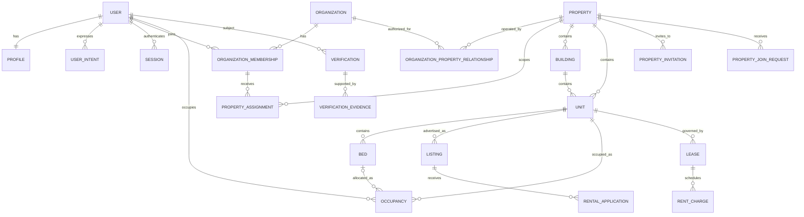
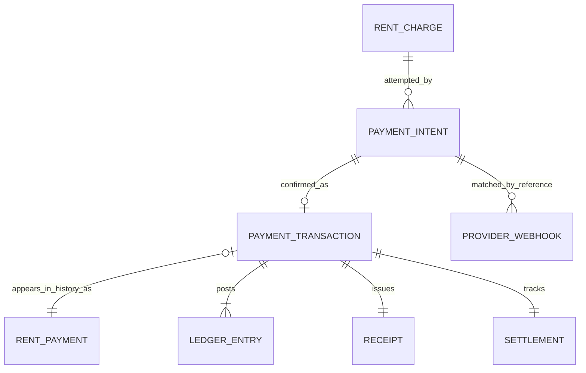

# Phase 4 database relationship map

Core distinctions:

- A `User` is one human account; intent is not a role.
- An `Organization` is an ownership/management workspace.
- A `Property` is private operational inventory by default.
- A `Building` and `Unit` model residential, commercial and hostel layouts
  without separate systems. A `Bed` is valid only under a `room` Unit whose
  parent Property has canonical type `hostel`; the service layer enforces this
  cross-table invariant because a database check cannot span the foreign key.
- A `Listing` is a public advertisement and has its own moderation lifecycle.
- An `Occupancy` records who lives in a unit or bed. It is separate from a
  lease, which is the contractual relationship.
- Historical invitations remain phone-bound, hash-only records with their
  original terminal state and links. They are read-only history: migration
  `occupancy.0011` revokes open rows and no invitation can authorize a new
  lease. A verified Unit may receive an explicitly created private access code.
  The database stores only its
  peppered hash, issue/expiry/revocation timestamps and version. Possession
  creates a pending request requiring a property-manager decision.

The legacy direct user/property fields and global role grants remain in a dual-
read transition. Data migrations create personal organizations, owner
memberships, authority relationships and intents for existing rows. Legacy Unit
codes were first cleared from unverified Units, then converted in place to
peppered hashes with a bounded compatibility expiry. Raw codes are no longer
readable from the database or normal Unit APIs.
Publication and public search remain fail-closed throughout the migration.

`IdempotencyKey` stores an actor-scoped endpoint/key claim, request fingerprint,
execution state, exact JSON response and optional resulting resource reference.
Consumer claims reference `User`; Management claims retain the isolated
reviewer's UUID. A null-safe unique constraint covers actor, management actor,
endpoint and key. PostgreSQL advisory locks serialise concurrent first claims,
while expiry and an hourly Celery purge bound replay storage. Migration
`idempotency.0003` adds Management scope without deleting existing response
history.

Payment Core reuses `RENT_CHARGE` as its obligation instead of duplicating it:

Only one created/pending/processing intent may hold a charge at a time, and a
provider transaction id is unique within its adapter. Confirmed transactions,
ledger lines and receipts are append-only in both Django and PostgreSQL.
Provider webhook rows store signature result, event identity and a SHA-256
payload digest; raw sensitive provider payloads are not retained. Existing
`RENT_PAYMENT` rows backfill to `party_confirmation`; only the signed Payment
Core path creates `verification_source=psp`.
