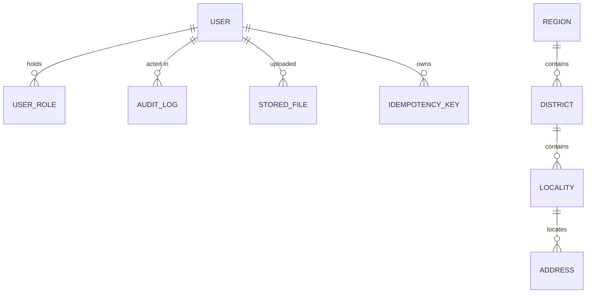
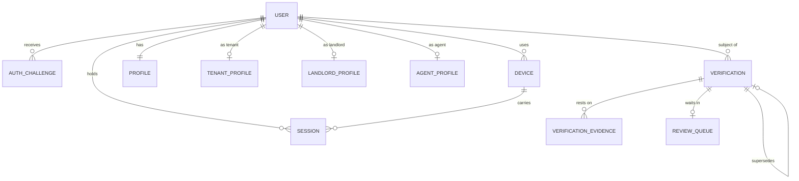
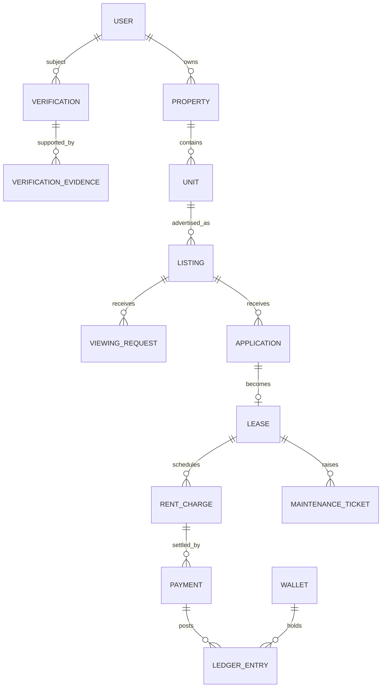

# Data model

Two things live in this document:

1. **Implemented** — tables that exist in Phase 0, with their columns and the
   reasoning behind the awkward parts.
2. **Designed, not built** — the shape of the domain tables that later phases
   will add. They are here because the Phase 0 tables were chosen to support
   them; they are *not* in the database and no migration creates them.

Nothing below is speculative implementation. It is the map that keeps Phase 5
from discovering that Phase 1 made an unrepairable decision.

---

## Conventions that apply to every table

| Rule | Why |
|---|---|
| `id UUID` primary key, UUIDv7 | Time-ordered so inserts stay at the right edge of the index; opaque so ids in URLs leak nothing and can be minted offline. |
| `created_at`, `updated_at`, both `timestamptz` | Stored UTC, rendered in `Africa/Accra`. |
| Soft delete via `deleted_at` on user-visible records | A listing taken down mid-dispute must still be readable. `objects` hides them; `all_objects` does not. |
| Money as `*_minor BIGINT` + `*_currency CHAR(3)` | Integers of pesewas. No floats, no naked amounts without a currency. |
| Phone numbers as E.164 `varchar(16)` | Normalised on write, so unique indexes actually mean one human. |
| Enums as `varchar` with `CHECK`-style choices in Django, not PostgreSQL `ENUM` | Adding a value to a PostgreSQL enum takes a lock and cannot be done inside a transaction with other DDL; states change often in a young product. |
| Foreign keys `ON DELETE PROTECT` by default | An accidental cascade through leases and payments is unrecoverable. |
| Indexes are declared with the model, and partial where the query is partial | e.g. the outbox dispatcher only ever reads rows that are pending and due. |

---

## Implemented in Phase 0

### `identity_user`

| Column | Type | Notes |
|---|---|---|
| `id` | uuid PK | |
| `phone` | varchar(16) **unique** | E.164. The credential. |
| `email` | varchar **unique, nullable** | Optional; unique index is partial so many users can have none. |
| `password` | varchar | Argon2. Unusable for OTP-only accounts. |
| `first_name`, `last_name`, `preferred_name` | varchar | `preferred_name` wins in the UI. |
| `is_active`, `is_staff`, `is_superuser` | bool | |
| `is_phone_verified`, `phone_verified_at` | bool, timestamptz | Proves the number reaches this person. Nothing more. |
| `preferred_language` | varchar(12) | `en` today; Twi and Ga are the first additions. |
| `data_saver` | bool | Suppresses image-heavy screens for users on metered data. |
| `deactivated_at` | timestamptz | Closure keeps the row; erasure is a separate, audited job. |

Indexes: `phone` unique, `email` unique partial, `created_at desc`.

### `identity_user_role`

One row per role grant. Roles are revoked, never deleted.

Constraints worth naming:
- unique `(user, role)` **where `revoked_at IS NULL`** — a user cannot hold the
  same role twice, but can be re-granted one they lost.
- unique `(user)` **where `is_primary AND revoked_at IS NULL`** — exactly one
  primary role at a time, enforced by the database rather than by hope.

### `audit_log`

Append-only, hash-chained. `previous_hash` links to the prior entry for the same
aggregate; `entry_hash` covers the row's content. `apps.audit.services.record`
serialises writers per aggregate with `SELECT ... FOR UPDATE` so the chain cannot
fork. `backend/apps/core/sql/audit_append_only.sql` removes UPDATE and DELETE from the
application role.

This is tamper *evidence*, not tamper proofing. Anyone with owner rights could
recompute the chain. Shipping entries off-box is the Phase 4 hardening step.

### `outbox_event`

Domain events written in the same transaction as the state change that caused
them. Statuses: `pending → processing → published`, or `→ failed` with
exponential backoff, or `→ dead` after `max_attempts`.

Partial index on `(status, available_at) WHERE status IN ('pending','failed')`:
the dispatcher's only query, and the index stays small even when the table holds
months of published events.

### `idempotency_key`

Unique on `(actor, endpoint, key)`. Stores the response so a replay returns the
original result, and a `request_fingerprint` so re-using a key with a different
body is a 409 rather than a wrong answer.

### `geo_region` / `geo_district` / `geo_locality` / `geo_address`

Reference hierarchy, seeded by `manage.py seed_geo`. `geo_locality.aliases` is a
JSON array of the other names a place goes by, so a tenant searching "Spintex"
reaches listings filed under "Sakumono".

`geo_address` keeps `landmark` free text alongside the structured fields. That is
not laziness: it is how people actually give directions here, and discarding it
would make the address less useful.

`coordinates_source` and `coordinates_confirmed_at` exist so the trust layer can
tell a surveyed pin from a number somebody typed.

### `file_stored`

Metadata only; bytes live in S3-compatible storage. Files start `pending` scan
and are unusable until `clean`. `is_sensitive` shortens signed-URL lifetimes and
turns reads into audited events. `retain_until` drives the deletion job for
identity documents.

---

## Added in Phase 1

### `identity_auth_challenge`

One OTP challenge. Never stores the code — only `code_hash` (HMAC-SHA256 under an
application-held pepper) and a per-challenge `code_salt`.

| Column | Notes |
|---|---|
| `phone` | E.164. Indexed; a challenge exists before any user does. |
| `user` | **Nullable** for an unknown `continue` number: the account is not created until the number is proven. |
| `purpose` | Consumer `continue`, plus `step_up`, `change_phone`, `recover_account`; legacy `sign_in`/`sign_up` remain during compatibility. Purpose binding prevents a consumer code authorising a sensitive action. |
| `attempts`, `send_count` | Attempts survive a resend. Otherwise "five guesses then resend" is unlimited guessing. |
| `expires_at`, `locked_until` | Five-minute life; fifteen-minute lockout after the attempt cap. |
| `device_fingerprint`, `ip_address` | Carried into the session, so a session records what proved the number. |

Partial index on `(phone, purpose, created_at desc) WHERE status = 'pending'` —
the verifier's only lookup.

### `identity_device`

An installation, not a person. `fingerprint` is generated by the client and kept
in the Keychain/Keystore on native or browser-profile storage on web. It is a
random Danpa HQ installation id, not a derived browser fingerprint and not a
credential. Unique on `(user, fingerprint)`.

Devices exist because they are the cheapest signal against SIM swap: an attacker
with a reissued SIM rarely also has the handset. `blocked_at` is set when a user
removes a device, and blocked devices cannot sign in.

### `identity_session`

| Column | Notes |
|---|---|
| `refresh_token_hash` | SHA-256, **unique**. The token itself is never stored. |
| `family_id`, `generation` | All rotations from one sign-in share a family. Reuse revokes the lineage, not one row. |
| `rotated_at`, `revoked_at`, `revoked_reason` | A rotated token is also revoked; presenting it again is the reuse signal. |

At most one unrevoked session may reference a device. Re-authenticating on the
same installation supersedes its earlier family; another installation keeps an
independent session. Revoked rows remain available as security history.

### `identity_profile` and the role profiles

One shared `identity_profile` per user, plus optional `identity_tenant_profile`,
`identity_landlord_profile`, `identity_agent_profile`.

Deliberately **not** one profile table per role: a person who lets one room while
renting another is normal here, and duplicating their name and photo across two
rows guarantees they drift apart.

`national_id_hash` + `national_id_last4` — the Ghana Card number is never stored
in the clear. The hash gives duplicate detection; the last four let support
confirm which card is being discussed.

`income_band` is banded, not exact: an exact salary is sensitive, invites
misreporting, and is not what a landlord decides on. `advance_months_affordable`
exists because the size of the advance a tenant can raise is the single biggest
determinant of whether a Ghanaian rental happens at all.

### `trust_verification`

The centre of the trust domain. See ADR 0013 for why each column is load-bearing.

| Column | Notes |
|---|---|
| `subject_type` + `subject_id` | Polymorphic: a user today, a property and a listing in Phase 2. |
| `kind` | phone, identity, selfie_match, address, agency, company, bank_account, ownership. |
| `status` | not_started → pending → needs_more_info → approved / rejected, then expired / revoked / superseded. |
| `method` | automated_otp, document_review, provider_api, site_visit, manual_override. |
| `decided_by`, `decided_at`, `expires_at` | Nullable decider for automated checks — recording "system" as a person would be a lie. |
| `decision_note` | Shown to the applicant. Must say what to do next. |
| `internal_note` | Reviewer-only. |
| `provider_response` | The authority's answer, verbatim, for disputes. |
| `supersedes` | Self-FK. Re-checking creates a new row and keeps the old one. |

Unique constraint `trust_one_live_verification` on
`(subject_type, subject_id, kind) WHERE status IN ('pending','needs_more_info','approved')`
— two approved identity checks on one person would force the UI to guess.

Partial indexes for the two hot queries: the review queue
(`status IN ('pending','needs_more_info')`) and the expiry sweep
(`status = 'approved' AND expires_at IS NOT NULL`).

### `trust_verification_evidence`

One artefact per row: `evidence_type`, an optional `file` (FK **PROTECT**, so a
file deletion cannot silently remove what a dispute rests on), a `reference` for
non-file evidence, and `checksum_at_attach` copied from the file so a dispute can
establish that the document shown today is the one reviewed in March.

`delete()` raises. Corrections supersede.

### `trust_review_queue`

A separate table rather than a query over verifications, because a queue has its
own concerns: `claimed_by`, `claimed_at`, `claim_expires_at` (30 minutes, so an
item is not lost because a reviewer closed their laptop), and `priority` — agents
and landlords outrank tenants because an unverified agent can take money from
many tenants.

### Validity periods

| Kind | Valid for | Why it ages |
|---|---|---|
| phone | 1 year | numbers are reassigned |
| identity | 2 years | documents expire, faces change |
| selfie_match | 1 year | as above |
| address | 1 year | people move |
| agency, company | 1 year | licences and registrations lapse |
| bank_account | 1 year | accounts close |
| ownership | no expiry | revoked, not expired |

These are judgement calls. They belong in a table that is revised against
evidence, not in folklore.

---

## Still designed, not built

Shapes the later phases will add. Column lists here are indicative, not final.

### Property and listings (Phase 2)

`property` (owner, address, type, ownership evidence), `unit` (bedrooms,
bathrooms, floor, furnished, private facilities — the fields that actually
differentiate a chamber-and-hall from a self-contained), `listing` (unit, rent,
`advance_months`, availability window, status), `listing_media` (ordered
`file_stored` references), `amenity` + `unit_amenity`.

Ghana-specific columns that will earn their place:
`advance_months` (2-year advance rent is common and is *the* reason people
borrow), `water_source`, `power_meter_type` (prepaid vs postpaid changes the
monthly cost materially), `compound_shared`, `security_type`.

### Rental workflow (Phase 3)

`viewing_request`, `application` (+ `application_document`), `lease`,
`lease_party`, `rent_charge` (the schedule; one row per due period, generated
ahead so a tenant can see what is coming), `rental_history`.

### Money (Phases 5–6)

`payment` (intent, provider, provider reference, status, idempotency key),
`payment_event` (raw provider callbacks, kept verbatim for dispute resolution),
`wallet`, `ledger_entry`.

The ledger is double-entry: every movement writes at least two rows summing to
zero, `balance` is derived rather than stored as a mutable field, and entries are
append-only like the audit log. `ledger_entry` carries
`(account_id, direction, amount_minor, currency, reference, posted_at)` with a
unique constraint on `(provider, provider_reference, direction)` so a retried
webhook cannot post twice.

Balances are read from a periodically-refreshed materialised view plus the
entries since its watermark: correct, and fast enough that a wallet screen does
not sum a million rows.

---

## Migration discipline

- Migrations are generated (`manage.py makemigrations`), reviewed as code, and never
  edited after being applied anywhere shared.
- Every migration must be safe to run while the previous version of the app is
  still serving traffic: add nullable, backfill in a job, then enforce. No
  single migration both adds a `NOT NULL` column and backfills it.
- Index creation on large tables uses `CONCURRENTLY` via
  `AddIndexConcurrently`, which cannot run inside a transaction — those
  migrations set `atomic = False`.
- Destructive changes (dropping a column, tightening a constraint) ship at least
  one release after the code that stopped depending on them.
